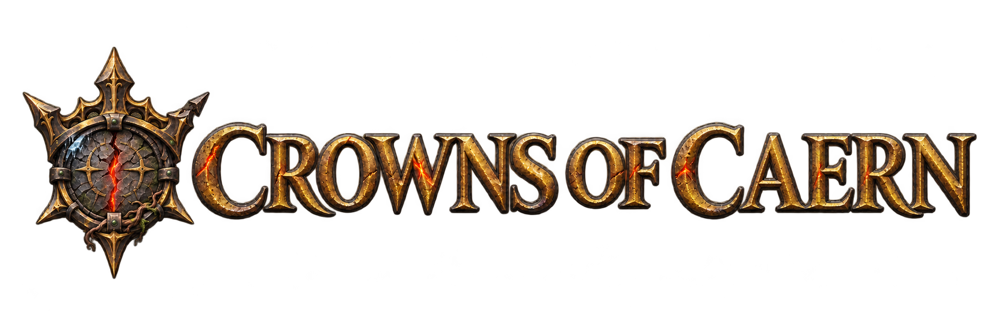
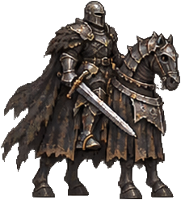
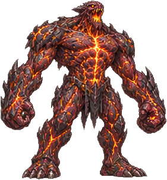
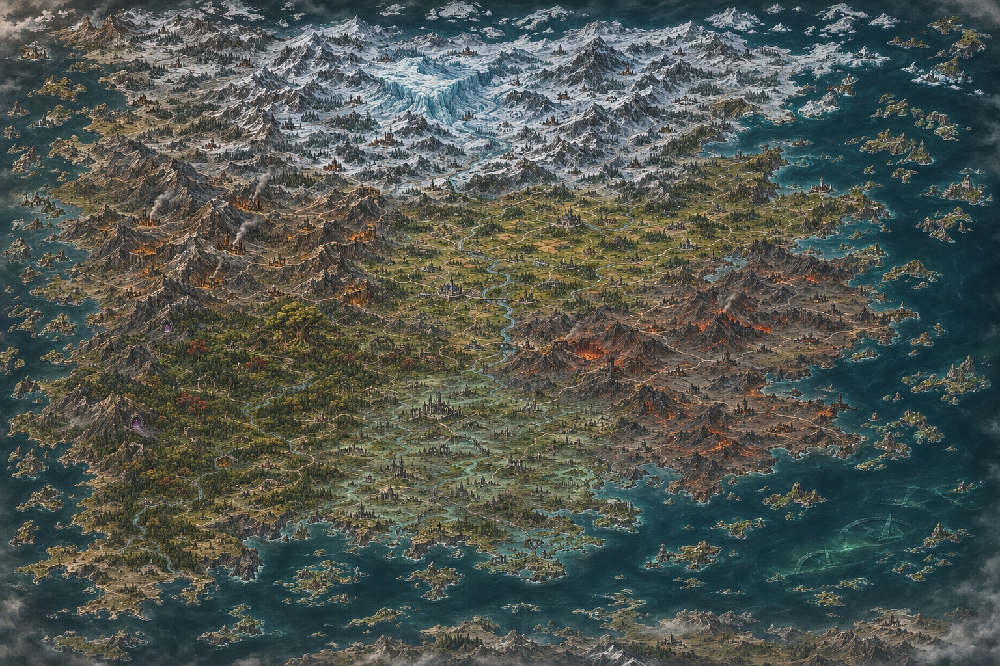
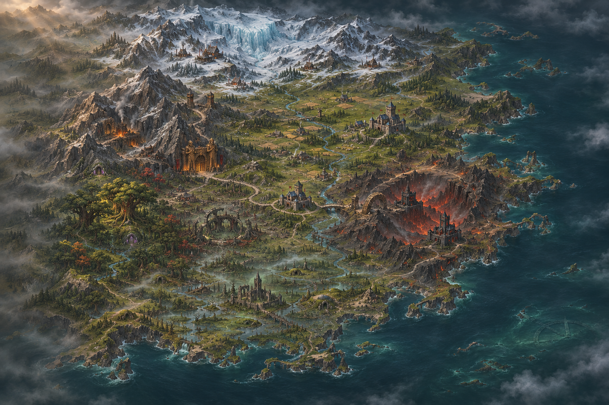
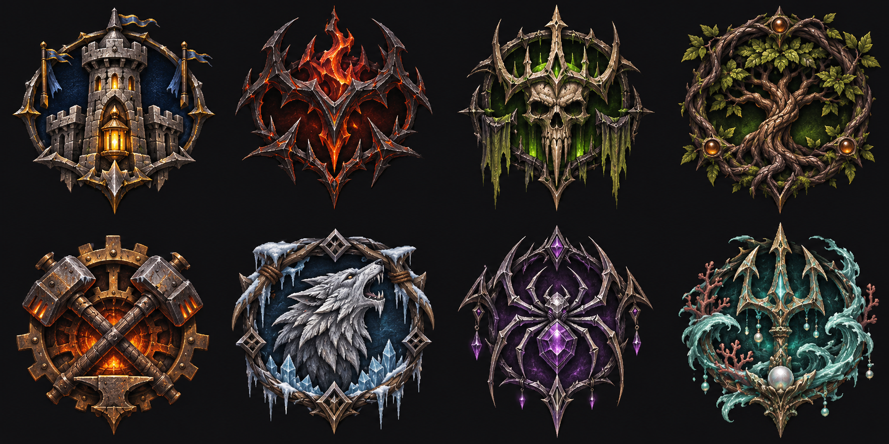
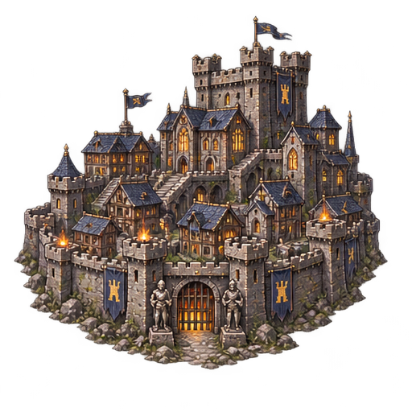
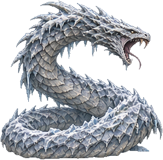

<p align="center">
  
</p>

<p align="center"><strong>Caern. A broken world. Eight rival powers. A crown worth burning for.</strong></p>
<p align="center">An original dark-fantasy, turn-based strategy game built with Godot.</p>

<table>
<tr>
<td width="160" align="center"></td>
<td>
<h2>Claim your kingdom</h2>
<p>Lead heroes across Caern, a world of ruined strongholds, haunted forests and burning wastes. Scout the roads, seize mines, gather seven resources and decide which battles your army can afford to fight.</p>
<p>Combat resolves automatically, shaped by terrain, army composition and hero skills. Victories leave scars: casualties matter, and your heroes grow across an entire campaign.</p>
</td>
<td width="160" align="center"></td>
</tr>
</table>

## The world of Caern

<p align="center"></p>
<p align="center"><em>The full world atlas: frozen north, forge mountains in the west, the cultivated marches at its heart and the burning Wound to the east.</em></p>

<p align="center"></p>
<p align="center"><em>The heartland where the six campaigns meet, painted in the style of the campaign journeys.</em></p>

## Eight powers, eight ways to wage war

<p align="center"></p>

| Faction | Their strength |
| --- | --- |
| **The Aldmere Concord** | Disciplined pikes, shields, bows and heavy cavalry. |
| **The Ashen Host** | Fast, brutal demonic armies that thrive on aggression. |
| **The Hollow Dominion** | Undead attrition, life-draining forces and the returning dead. |
| **The Thornwood Covenant** | Ranged hunters sheltered by ancient living trees. |
| **The Sunken Forge** | Armoured constructs, siege guns and furnace-born power. |
| **The Frostmarch Clans** | Numerous raiders, beast cavalry and frozen resolve. |
| **The Umbral Court** | Venom, shadow magic and the horrors of the deep earth. |
| **The Abyssal Shoal** | Armoured reef creatures and monsters of the deep. |


<table>
<tr>
<td width="190" align="center"></td>
<td>
<h2>Build something worth defending</h2>
<p>Develop towns through faction building trees, recruit from dwellings, reinforce garrisons and secure the income that keeps your armies moving. Every day allows one new building; every week brings fresh recruits.</p>
<p>Explore handmade maps or seeded procedural worlds with guarded passes, treasure pockets and neutral towns. Play against computer opponents or share a hot-seat game.</p>
</td>
</tr>
</table>

<table>
<tr>
<td>
<h2>Carry the campaign</h2>
<p>Heroes gain experience, learn skills and lead armies whose composition changes with every loss and reinforcement. Fog of war and terrain-weighted movement make scouting and route planning part of every turn.</p>
<p>Save across six slots plus an autosave. Win by conquest, defend your towns and survive long enough to bring your rivals down.</p>
</td>
<td width="190" align="center"></td>
</tr>
</table>

## Installation

There are currently no packaged downloads in the repository's [Releases](https://github.com/CrownsofCaern/Crowns_of_Caern_4X/releases). To play on Windows or macOS, download the project and run it using the Godot editor. The iPhone version must be built and signed on a Mac.

### Windows PC

1. Download and extract the **standard** Windows version of [Godot 4.5.1](https://godotengine.org/download/archive/4.5.1-stable/).
2. On this repository's GitHub page, choose **Code → Download ZIP**, then extract the ZIP. Alternatively, clone the repository with Git.
3. Open Godot, choose **Import**, browse to the extracted project's `project.godot`, and import it.
4. Open the project, wait for the initial asset import to finish, then press **F5** or the play button to start the game.

### Mac

1. Download the **standard** macOS version of [Godot 4.5.1](https://godotengine.org/download/archive/4.5.1-stable/) and install it.
2. On this repository's GitHub page, choose **Code → Download ZIP**, then extract the ZIP. Alternatively, clone the repository with Git.
3. Open Godot, choose **Import**, select the extracted project's `project.godot`, and import it.
4. Open the project, wait for the initial asset import to finish, then press **F5** or the play button to start the game.

### iPhone

An iPhone build requires a **Mac**, **Xcode**, an Apple ID, Godot 4.5.1 with its matching export templates, and an iPhone running iOS 15 or later. There is no App Store or TestFlight download provided here.

1. Follow the Mac steps above to download and import the project. In Godot, use **Editor → Manage Export Templates** to install the matching templates.
2. Open Xcode once, install its requested components, and add your Apple ID under **Xcode → Settings → Accounts**.
3. In Godot, open **Project → Export → iOS** and enter your Apple team ID under **Application → App Store Team ID**. Export the project using the existing iOS preset.
4. Open the exported Xcode project, enable automatic signing for the app target, select your team and choose a unique bundle identifier if needed.
5. Connect and trust your iPhone, enable **Developer Mode** in its Privacy & Security settings, select it in Xcode and press **Run**. Trust the developer on the phone if prompted.

A free Apple account can be used for personal device builds, but the signing expires after seven days and the app must be installed again. See the [detailed iPhone guide](docs/IOS.md) for commands, touch controls and known limitations. The interface is landscape and may have small text on a phone.

## Play

Install **Godot 4.5.x**, open `project.godot` in the editor and press **F5** to run the project. From a terminal:

```sh
godot --path .
```

The title screen offers campaigns and new-game setup with map, faction, player slots, seed and difficulty options. Campaigns open as painted regional journeys: select a numbered destination to inspect the mission, continue at the gold stop, and zoom or drag to explore the map.

Choose **Map Editor** to create local drafts, configure players, and edit terrain,
roads, scenery, objects and heroes on copies of bundled maps. See the [map editor guide](docs/MAP_EDITOR.md) for controls
and the features still in progress.

| Action | Controls |
| --- | --- |
| Plan / march | Click a tile, then click again; `Space` follows the planned route |
| Cancel route | Right-click |
| End turn | `E` |
| Hero / army | `H`; `Tab` selects the next hero |
| Town | `T`; `Tab` switches towns in the town screen |
| Look around | Arrow keys, minimap; `C` centres on your hero |
| Zoom | Mouse wheel, `+` / `-`, trackpad pinch; `0` resets |
| Scout an enemy | Point at the army and press `S` |
| Save / load | `F5` / `F9` |
| Menu / close | `Esc` |

Move, merge or swap army stacks by selecting a stack and then a destination slot. Use **Split** or **Shift+click** to move part of a stack. In battle dialogs, `Enter` attacks or continues, `S` scouts and `Esc` withdraws.

On touch screens, tap to plan, tap again to march, hold for information, drag to pan and use two fingers to cancel a route. See the [iPhone build guide](docs/IOS.md).

## Develop

The game separates headless rules from the Godot UI, with content defined in JSON and deterministic gameplay randomness under a fixed seed.

```sh
./run_tests.sh
# Start directly with a fixed seed or a generated map:
godot --path . -- --seed=123
godot --path . -- --map=gen:twin_marches:7
# Inspect map generation and simulate a match:
godot --headless --path . --script res://tools/mapgen_preview.gd -- twin_marches 7
godot --headless --path . --script res://tools/ai_match.gd -- twin_marches 1 28 1
```

- [Game manual](docs/manual/README.md): the illustrated player manual and these docs as one website. Build it with `python3 tools/manual/build_manual.py` and open `export/manual/index.html`.
- [Design and architecture](docs/DESIGN.md)
- [Faction guide](docs/FACTIONS.md)
- [Art direction](docs/ART_BIBLE.md)
- [Asset pipeline](tools/assets/README.md)
- [Guide for coding agents](CLAUDE.md)


## Gameplay variety

New Game first picks a **Mode**, then a map: a **random map** (size, players, layout
family or Any, teams, monsters, treasure, all rebuilt from the seed), one of the
**curated seeds** (named maps that always play the same land) or one of your own editor maps.

- **Conquest:** last player or team standing. Layouts: Ring, Hub, Archipelago, and for
  two players Diagonal, Lanes and Branching.
- **Townless start:** a lone hero, guarded villages to recruit from and a neutral town to take.
- **Survival** holds a stronghold through a final siege. **Three strongholds** requires
  three keeps to remain yours. **Endless survival** continues with stronger invasions.
  **Expedition** races to a labyrinth's centre in 21 days.

The **Objectives** button opens mission orders, deadlines, entry locations, and quests.
Visit marked mission sites to speak to their inhabitants or secure support. After
clearing the Hollow Nest, click it again to **Seal the tunnel**; attackers then use
an alternate road. Restore the watch for earlier warnings, destroy the supply camp
to weaken future waves, or earn an independent ally by returning its guarded relic.
Quest relics use a dedicated inventory; the Objectives journal lets adjacent heroes
hand them to one another. Easy/Normal/Hard invasions use 75%/100%/125% army strength.

The three-chapter **The Long Watch** campaign combines survival, multi-town defence,
and the timed labyrinth, with normal campaign hero progression. Generated neutral
armies mostly match their final tile's terrain; occasional outsiders remain possible.

Implementation and verification: [gameplay update plan](docs/GAMEPLAY_VARIETY_PLAN.md)
and [verification report](docs/reports/GAMEPLAY_VARIETY_VERIFICATION.md).
