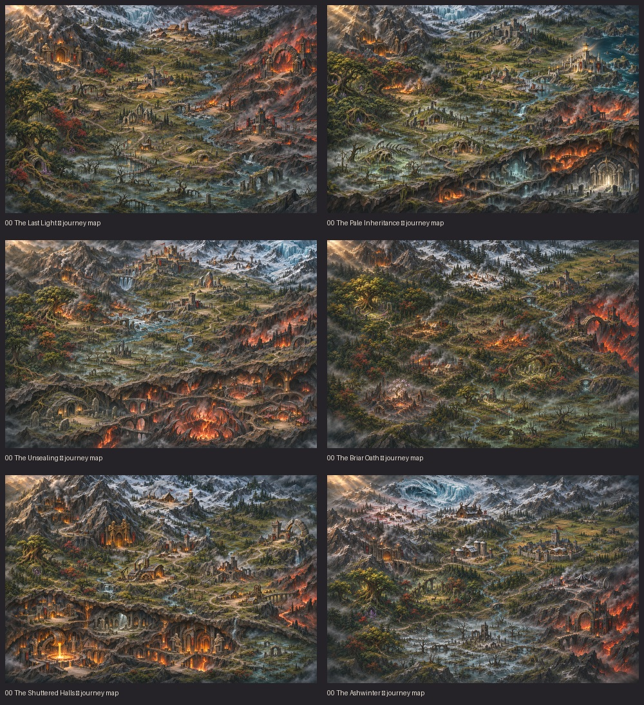

# Campaign journeys — production menu integration

Open **Campaign** from the main menu and choose a campaign in the top selector. Each of the six campaigns has its own full-resolution regional painting and ten clickable chapter stops. This replaces the old scrolling chapter list.

- Green stops are won, gold is the current destination, grey stops are locked. Any stop can be inspected; only the current chapter can launch. Completed stops do not rewind the campaign or its veteran roster.
- The sidebar shows the selected mission's actual name, story, hero level cap and creature tier cap. Begin, continue an active save, play the next chapter and confirmed start-over retain the existing `Campaign`/`AdventureScreen` flow.
- After a chapter victory, **Next chapter** opens this journey view before the next briefing. The campaign's leading hero travels from the previous destination to the current one using the existing movement clip. Defeats retain retry. Hero motion can be turned off.
- Zoom buttons and wheel zoom enlarge the map; drag it with a mouse or touch. Portrait layouts place the description below the painting. Underground route legs are dashed and the relevant paintings distinguish surface and cutaway destinations.

The regional paintings follow the original approved map style, rather than cropping the schematic empire atlas. Local distances are composed for clarity. Actual chapter IDs and shared location identities are bound in `assets/specs/campaign_journeys.json`; `world_atlas.json` remains the world geography reference. The two visits to Elderwold's stumps use nearby stops in the same painted area.



## Actual Godot menu captures

The screenshots use in-memory progress fixtures to show different UI states; the review script never writes player saves.

- [The Last Light](last_light.png)
- [The Pale Inheritance](pale_inheritance.png)
- [The Unsealing](unsealing.png)
- [The Briar Oath](briar_oath.png)
- [The Shuttered Halls](shuttered_halls.png)
- [The Ashwinter](ashwinter.png)
- [Hero travelling](hero-travelling.png)
- [Locked mission preview](locked-preview.png)
- [Campaign complete](campaign-complete.png)
- [Portrait](portrait.png) / [portrait zoom](portrait-zoom.png)
- [Phone](phone.png) / [phone zoom](phone-zoom.png)

Sources, exact prompts, campaign story snapshot, conditioning reference and hashes are preserved in `assets/source/batches/campaign-journeys-001/`. Runtime images are exported through the existing `pipeline.py illustrations` command and `assets/campaign_art.json`, with usage `journey`. They retain all source pixels and dimensions, without sprite-atlas downsampling or palette quantisation. Chapter briefing paintings are preserved separately.

Reproduce captures:

```sh
xvfb-run -a godot --path . --audio-driver Dummy --rendering-driver opengl3 --script res://tools/campaign_journey_review.gd
```

See [the developer handoff](../../CAMPAIGN_JOURNEYS_REPORT.md) for implementation and validation.
