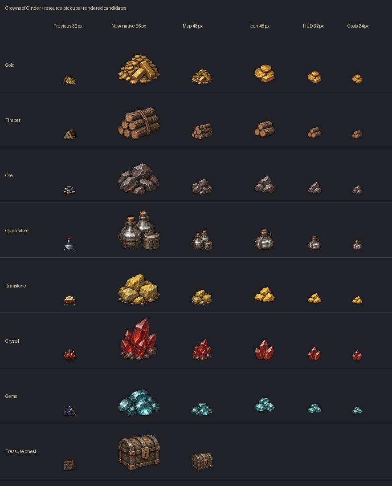

# Resource pickup review

Seven resource piles, seven dedicated interface icons and a treasure chest.
Rendered candidates, pending artistic approval.

[Developer report](../../RESOURCE_ART_REPORT.md) · [Native/actual-scale comparison](contact.png)

## Godot captures

- [Normal map zoom and resource HUD](map-and-resource-hud-godot.png).
- [Zoomed-out map](map-zoomed-out-godot.png).
- [Town recruitment costs](town-and-resource-costs-godot.png).
- [Building resource costs](building-resource-costs-godot.png).

Map sprites are 96px native and 48px on the map. Interface sprites are 48px
native, displayed at 32px in the HUD and 24px in cost rows. Resource IDs,
quantities, prices and pickup behavior are unchanged.
