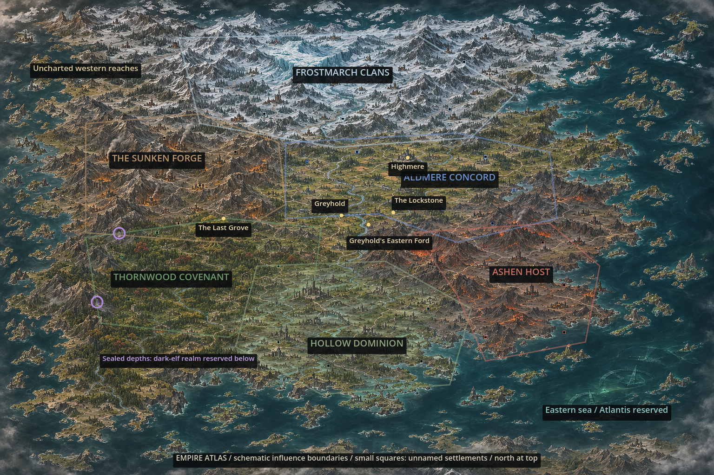

# World atlas review — empire scale

Geography and the original painterly **regional campaign style** are approved. The revised full-world atlas zooms out to show six empires, numerous settlements and broader hinterlands. Individual campaign paintings will use closer compositions and can compress distances.

[Direction, preserved geography and developer handoff](../../WORLD_ATLAS_PROPOSAL.md)

Subtle outlines indicate schematic spheres of influence. Small squares represent unnamed cartographic settlements, not new campaign levels. The eastern sea reserves Atlantis; the dark elves remain a separate deep underground layer. Source art is preserved without labels or overlays.

## Geographic route indexes — not final campaign paintings

- [The Last Light](last_light-route-proposal.png)
- [The Pale Inheritance](pale_inheritance-route-proposal.png)
- [The Unsealing](unsealing-route-proposal.png)
- [The Briar Oath](briar_oath-route-proposal.png)
- [The Shuttered Halls](shuttered_halls-route-proposal.png)
- [The Ashwinter](ashwinter-route-proposal.png)

Numbers follow actual chapter order. Dashed legs use underground passages; return journeys and revisited places are intentional. The final regional paintings will show specific towns, ruins, forests and other destinations appropriate to the mission, following the original approved painting's style rather than the schematic atlas.
